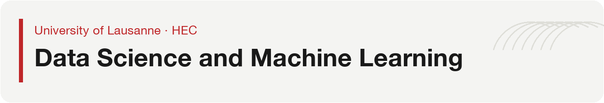
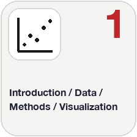
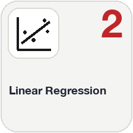
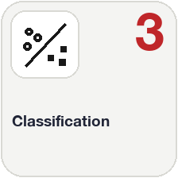
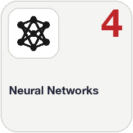
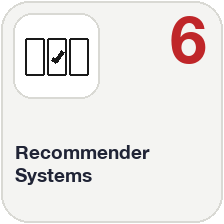
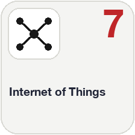
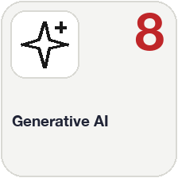
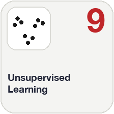
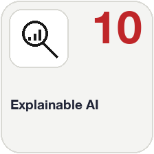

<h1></h1>

**Instructor** · [Prof. M. Vlachos](https://people.unil.ch/michalisvlachos/) 
**Teaching Assistants** · Stergios Konstantinidis & Vikhyat Agrawal

[Weekly labs](./Labs/README.md) · [Assignments](./Assignments/README.md) · [Lab slides](./Labs/_menti_files/readme.md)

## Weekly labs

The schedule may change. Download each lab during its scheduled week.

<table>
  <tr>
    <td></td>
    <td></td>
    <td></td>
    <td></td>
    <td></td>
  </tr>
  <tr>
    <td></td>
    <td></td>
    <td></td>
    <td></td>
    <td></td>
  </tr>
</table>
